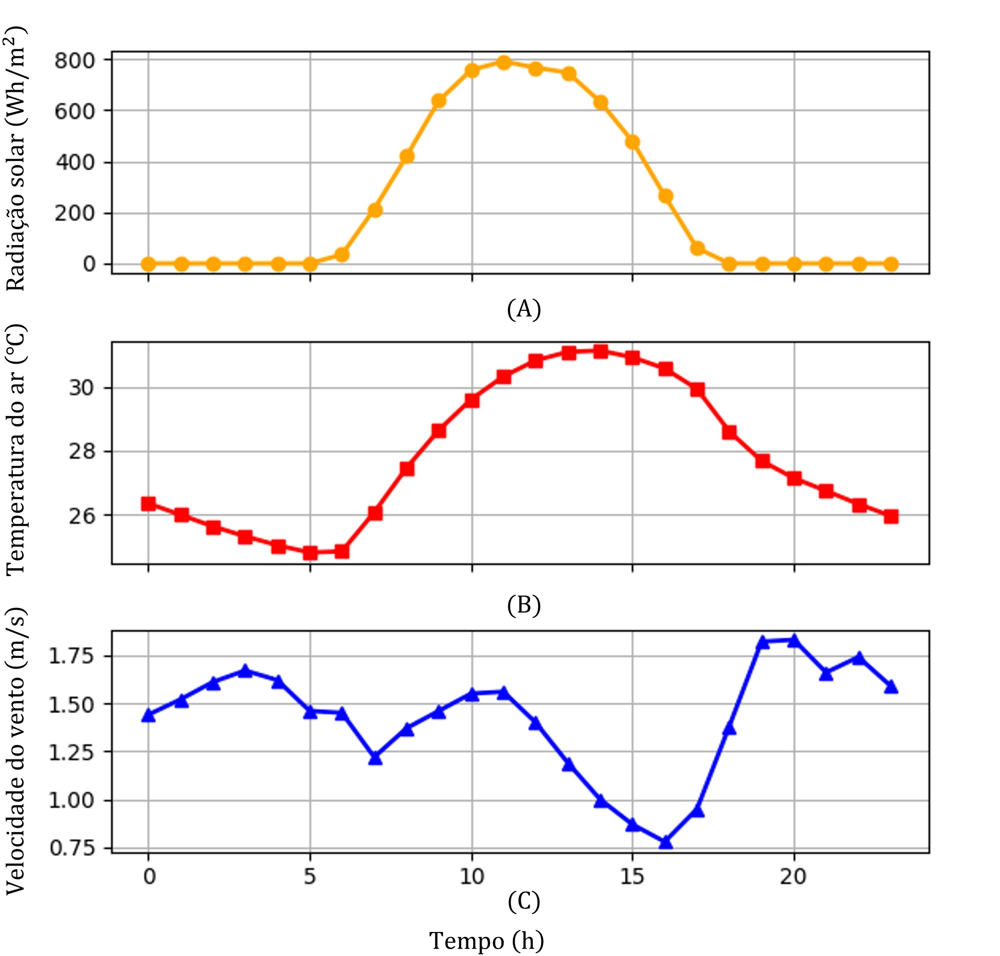
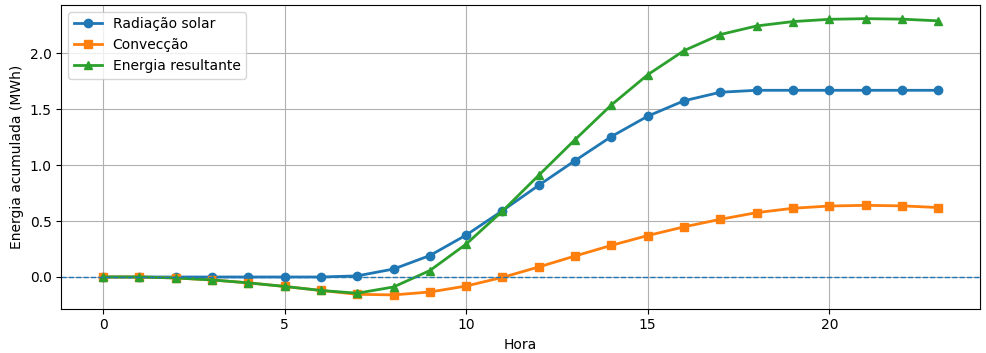

[](https://colab.research.google.com/github/NuclearPhysicist/styrene-accident-physics-modeling/blob/main/styrene_accident_manaus.ipynb)

# Computational Modeling of Heat Transfer in a Styrene Storage Tank in Manaus

This repository presents a computational investigation of heat transfer in a styrene storage tank associated with the industrial incident reported in Manaus, Brazil, in July 2026.

The project was developed as an investigative learning resource for Physics education, combining physical modeling, meteorological data, numerical calculations, and graphical analysis.

## Overview

The computational notebook investigates how environmental conditions influence the thermal behavior of styrene stored in an industrial tank.

The model considers:

- Solar radiation absorbed by the tank;
- Convective heat transfer between the tank and ambient air;
- An illustrative analysis of heat conduction through the steel wall;
- The global energy balance and temperature evolution of the styrene;
- Thermal power and accumulated energy over time.

The main research question is:

**Are solar radiation and convection sufficient to explain the temperatures reported during the incident?**

The model is a simplified educational representation and does not aim to reproduce the complete industrial accident.

## Example Results

### Meteorological Conditions

Hourly solar irradiation, air temperature, and wind speed were obtained from NASA POWER. The reference data correspond to July 15, 2025, because data for the incident date in 2026 were not available when the study was prepared.

These data represent a reference scenario, not a reconstruction of the actual weather conditions during the incident.



### Accumulated Thermal Energy

The notebook calculates the energy contributions from solar radiation and convection and their combined effect over the simulated period.



## Educational Context

The notebook supports investigative learning through the application of Physics concepts to a real-world technological scenario.

Topics include:

- Heat and temperature;
- Thermal capacity;
- Solar radiation and absorbed power;
- Convection and Newton's law of cooling;
- Heat conduction through a solid wall;
- Conservation of energy and global energy balance;
- Numerical integration and graphical interpretation;
- Assumptions and limitations of physical models.

## Computational Notebook

The main notebook is:

`styrene_accident_manaus.ipynb`

It contains explanatory text, equations, editable parameters, Python code, numerical calculations, and graphical results.

### Main Sections

1. **Libraries:** imports the required Python libraries.
2. **Editable Parameters:** defines tank geometry and model parameters.
3. **Tank Data:** calculates geometric properties and estimates the steel shell mass.
4. **Styrene Properties:** defines the thermophysical properties used in the model.
5. **Environmental Conditions:** loads and processes meteorological data from NASA POWER.
6. **Heat Transfer:** calculates heat-transfer areas, styrene mass, solar absorption, convection, an illustrative wall-conduction estimate, and the global energy balance.

## Main Physical Models

### 1. Solar Radiation

The absorbed solar power is estimated using the solar absorptivity, incident irradiance, and projected area of the tank.

### 2. Convection

Heat transfer between the tank and ambient air is estimated using Newton's law of cooling and an empirical correlation for the convective heat-transfer coefficient.

### 3. Heat Conduction

Fourier's law is used in a separate illustrative calculation to estimate the temperature difference across the steel wall. Conduction is not included as an independent term in the main energy balance.

### 4. Global Energy Balance

Solar and convective heat-transfer rates are combined in a lumped-capacitance model to estimate the mean temperature evolution of the styrene over the simulated period.

## Meteorological Data

Data are obtained from the NASA POWER Data Access Viewer:

https://power.larc.nasa.gov/data-access-viewer/

The notebook uses the following hourly variables:

- All Sky Surface Shortwave Downward Irradiance;
- Temperature at 2 Meters;
- Wind Speed at 10 Meters.

Instructions for downloading and loading the data are provided in the notebook.

## Running the Notebook

1. Click **Open in Colab** at the top of this page.
2. Save a copy to Google Drive if you want to edit the notebook.
3. Run the cells in order, starting from the beginning.
4. Upload the CSV file downloaded from NASA POWER when prompted.
5. To test alternative scenarios, modify the editable parameters and rerun the dependent cells.

## Requirements

The notebook uses Python and the following libraries:

- NumPy
- Matplotlib
- Pandas

Dependencies can be installed using:

```bash
pip install -r requirements.txt
```

Google Colab generally provides these libraries by default.

## Scope and Limitations

The model is intended for educational investigation and does not establish the cause of the actual incident.

Its main limitations are:

- Meteorological data from July 15, 2025, are used as a reference scenario.
- Some tank dimensions and construction parameters are estimated or simplified.
- The lumped-capacitance model assumes a uniform mean temperature for the styrene.
- The main energy balance considers solar radiation and convection.
- The wall-conduction calculation is illustrative only.
- Internal heat generation due to styrene polymerization is not included in the current model.

These limitations provide opportunities to discuss model assumptions and investigate additional physical mechanisms in future work.

## Repository Contents

- `styrene_accident_manaus.ipynb` — computational notebook.
- `figures/meteorologia.png` — meteorological data.
- `figures/energiaacumulada.png` — accumulated thermal energy.
- `requirements.txt` — Python dependencies, if provided.

## License and Use

Please consult the repository license, if available, for reuse conditions. When using the notebook or figures in academic or educational work, cite the repository and the relevant data sources.
